# Roadmap de la Migración (Strangler Fig)

Evolución de la arquitectura desde los sistemas heredados en IIS hasta la infraestructura 100% moderna, pasando por la protección con WAF/Gateway, la centralización de la identidad (IDP) y la coexistencia de backends y SPA nuevos con el legacy.

```mermaid
flowchart TB
    %% Estilo de nodos
    classDef legacy fill:#b8b8b8,stroke:#666,stroke-width:2px,color:#000
    classDef modern fill:#b7e1a1,stroke:#5c8a47,stroke-width:2px,color:#000
    classDef spa fill:#6be3d6,stroke:#359c91,stroke-width:2px,color:#000
    classDef gateway fill:#7eb0d5,stroke:#4a7c9b,stroke-width:2px,color:#000
    classDef waf fill:#f7a35c,stroke:#c46d25,stroke-width:2px,color:#000
    classDef idp fill:#3d4a6d,stroke:#1e2638,stroke-width:2px,color:#fff
    classDef infraLegacy fill:#f2f2f2,stroke:#999,stroke-dasharray: 5 5,color:#333
    classDef infraModern fill:#e8f8f5,stroke:#2ecc71,stroke-dasharray: 5 5,color:#1b7a43

    subgraph Paso1 ["1. Estado Inicial"]
        direction TB
        subgraph IIS_1 ["Servidor Windows / IIS"]
            L1_1["Sistema Heredado 1<br/>(Web Forms)"]:::legacy
            L2_1["Sistema Heredado 2<br/>(Web Forms)"]:::legacy
        end
        class IIS_1 infraLegacy
    end

    subgraph Paso3 ["3. Protección WAF y Gateway"]
        direction TB
        WAF_3["Cloudflare / Nginx (WAF)"]:::waf --> GW_3["API Gateway"]:::gateway
        subgraph IIS_3 ["Servidor Windows / IIS"]
            L1_3["Heredado 1 (Web Forms)"]:::legacy
            L2_3["Heredado 2 (Web Forms)"]:::legacy
        end
        GW_3 --> L1_3 & L2_3
        class IIS_3 infraLegacy
    end

    subgraph Paso4 ["4. Gestión de Identidad (IDP)"]
        direction TB
        WAF_4["Cloudflare / Nginx (WAF)"]:::waf --> GW_4["API Gateway"]:::gateway
        IDP_4["Gestor de Identidad (IDP)<br/>JWT / OAuth 2.0"]:::idp <--> GW_4
        subgraph IIS_4 ["Servidor Windows / IIS"]
            L1_4["Heredado 1 (Web Forms)"]:::legacy
            L2_4["Heredado 2 (Web Forms)"]:::legacy
        end
        GW_4 --> L1_4 & L2_4
        IDP_4 -. "identidad" .-> IIS_4
        class IIS_4 infraLegacy
    end

    subgraph Paso5 ["5. Primer Backend Moderno (sin SPA)"]
        direction TB
        WAF_5["Cloudflare / Nginx (WAF)"]:::waf --> GW_5["API Gateway (Mismo Dominio)"]:::gateway
        IDP_5["Gestor de Identidad (IDP)"]:::idp <--> GW_5

        subgraph IIS_5 ["Servidor Windows / IIS (Legacy)"]
            L1_5["Heredado 1"]:::legacy
            L2_5["Heredado 2"]:::legacy
        end

        subgraph Cloud_5 ["Entorno Linux / Docker / App Service"]
            BE1_5["Nuevo Backend 1<br/>(APIs Modernas)"]:::modern
        end

        GW_5 --> L1_5 & L2_5 & BE1_5
        L1_5 -. "Consume con JWT" .-> BE1_5
        class IIS_5 infraLegacy
        class Cloud_5 infraModern
    end

    subgraph Paso6 ["6. Coexistencia Multi-Infraestructura (con SPA)"]
        direction TB
        WAF_6["Cloudflare / Nginx (WAF)"]:::waf --> GW_6["API Gateway (Mismo Dominio)"]:::gateway
        IDP_6["Gestor de Identidad (IDP)"]:::idp <--> GW_6

        subgraph IIS_6 ["Servidor Windows / IIS (Legacy)"]
            L1_6["Heredado 1"]:::legacy
            L2_6["Heredado 2"]:::legacy
        end

        subgraph Cloud_6 ["Entorno Linux / Docker / App Service"]
            SPA_6["Nueva SPA<br/>(Angular / React)"]:::spa
            BE1_6["Nuevo Backend 1<br/>(APIs Modernas)"]:::modern
            SPA_6 --> BE1_6
        end

        GW_6 --> L1_6 & L2_6 & SPA_6 & BE1_6
        L1_6 -. "Consume con JWT" .-> BE1_6
        class IIS_6 infraLegacy
        class Cloud_6 infraModern
    end

    subgraph Paso7 ["7. Descomisionado Parcial"]
        direction TB
        GW_7["API Gateway"]:::gateway

        subgraph IIS_7 ["Servidor Windows / IIS"]
            L2_7["Heredado 2<br/>(Último remanente)"]:::legacy
        end

        subgraph Cloud_7 ["Entorno Linux / Docker / App Service"]
            SPA_7["Nueva SPA"]:::spa
            BE1_7["Nuevo Backend 1"]:::modern
            BE2_7["Nuevo Backend 2"]:::modern
            SPA_7 --> BE1_7 & BE2_7
        end

        GW_7 --> L2_7 & SPA_7 & BE1_7 & BE2_7
        class IIS_7 infraLegacy
        class Cloud_7 infraModern
    end

    subgraph Paso8 ["8. Migración Completada (IIS Apagado)"]
        direction TB
        WAF_8["Cloudflare / Nginx (WAF)"]:::waf --> GW_8["API Gateway (ejemplo.com)"]:::gateway
        IDP_8["Gestor de Identidad (IDP)"]:::idp <--> GW_8

        subgraph Cloud_8 ["Infraestructura 100% Moderna (Linux / Docker / Cloud)"]
            SPA_8["Nueva SPA<br/>(Angular / React)"]:::spa
            BE1_8["Nuevo Backend 1"]:::modern
            BE2_8["Nuevo Backend 2"]:::modern
            SPA_8 --> BE1_8 & BE2_8
        end

        GW_8 --> SPA_8 & BE1_8 & BE2_8
        class Cloud_8 infraModern
    end

    Paso1 ==> Paso3 ==> Paso4 ==> Paso5 ==> Paso6 ==> Paso7 ==> Paso8
```

## Leyenda

| Color | Elemento |
|---|---|
| Gris | Sistemas heredados (Web Forms en IIS) |
| Naranja | WAF (Cloudflare / Nginx) |
| Azul | API Gateway |
| Azul oscuro | Gestor de Identidad (IDP) |
| Verde | Backends modernos |
| Turquesa | SPA (Angular / React) |
